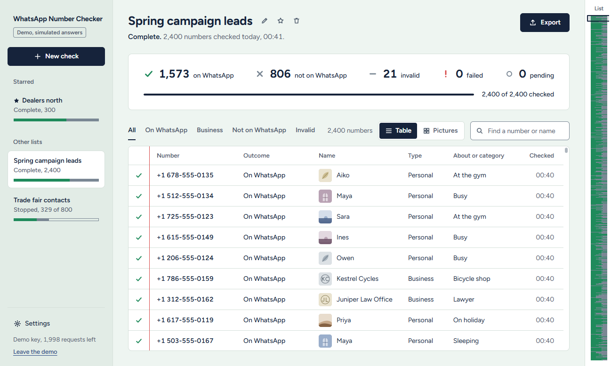
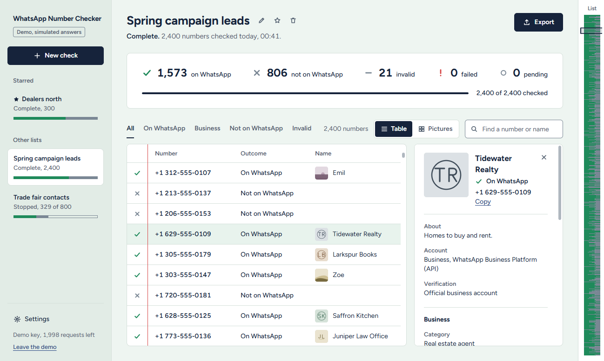
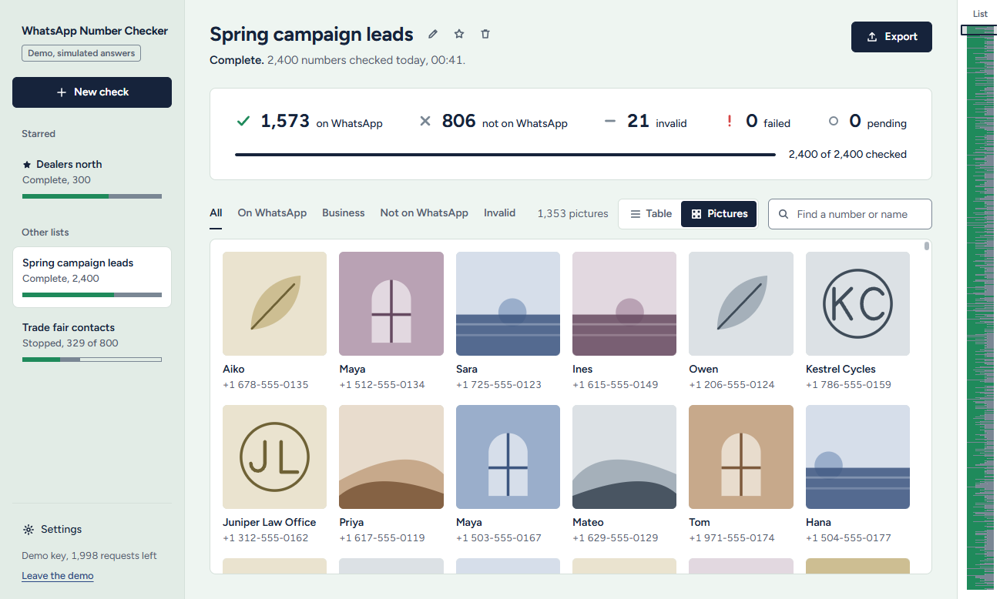
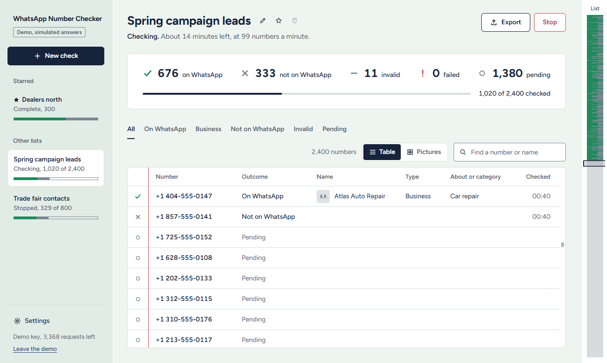
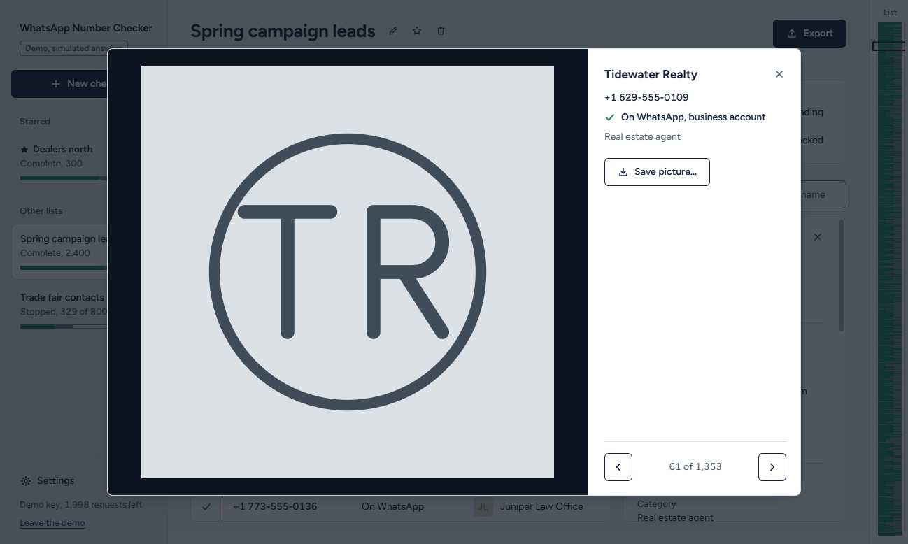

# WhatsApp Number Checker

[](https://github.com/eduair94/whatsapp-scraping-tool/releases/latest)
[](https://github.com/eduair94/whatsapp-scraping-tool/releases)
[](https://github.com/eduair94/whatsapp-scraping-tool/actions/workflows/ci.yml)
[](LICENSE)

Find out which numbers of a list are on WhatsApp, and what their profiles say:
name, about, profile picture, and the whole business profile. Open a CSV or
Excel file (or paste the numbers), start the check, and export the answers to
Excel, CSV or JSON. A free, open-source desktop app for Windows, macOS and
Linux.



## Download

| System | |
| --- | --- |
| Windows 10 and 11 | [Installer](https://github.com/eduair94/whatsapp-scraping-tool/releases/latest/download/whatsapp-number-checker-windows-setup.exe) · [Portable, no install](https://github.com/eduair94/whatsapp-scraping-tool/releases/latest/download/whatsapp-number-checker-windows-portable.exe) |
| macOS 12 and later | [Apple silicon (M1 and later)](https://github.com/eduair94/whatsapp-scraping-tool/releases/latest/download/whatsapp-number-checker-mac-arm64.dmg) · [Intel](https://github.com/eduair94/whatsapp-scraping-tool/releases/latest/download/whatsapp-number-checker-mac-x64.dmg) |
| Linux, 64-bit | [.deb for Ubuntu, Debian, Mint](https://github.com/eduair94/whatsapp-scraping-tool/releases/latest/download/whatsapp-number-checker-linux-x64.deb) · [AppImage, any distribution](https://github.com/eduair94/whatsapp-scraping-tool/releases/latest/download/whatsapp-number-checker-linux-x64.AppImage) |

All files and their checksums are on the [latest release](https://github.com/eduair94/whatsapp-scraping-tool/releases/latest).
More about the app: [whatsapp.checkleaked.cc/tools/bulk-checker-app](https://whatsapp.checkleaked.cc/tools/bulk-checker-app).

**First time?** The [user guide](docs/GUIDE.md) walks through installing on each
system, your key, adding numbers, checking, reading the results and exporting,
with screenshots. To look around without a key, open **Help → Try the Demo**.

The builds are not code-signed yet, so each system asks once:

- **Windows**: "Windows protected your PC" → **More info → Run anyway**.
- **macOS 15 and later**: after the first try, **System Settings → Privacy &
  Security → Open Anyway**. On macOS 14 and earlier, right-click the app →
  **Open** → **Open**. If it says the app is damaged, run
  `xattr -dr com.apple.quarantine "/Applications/WhatsApp Number Checker.app"` once.
- **Linux**: `sudo apt install ./whatsapp-number-checker-linux-x64.deb`, or
  `chmod +x` the AppImage and run it (it needs FUSE 2, `libfuse2t64` on
  Ubuntu 24.04).

## What it does

- **Reads your list as it is.** CSV, Excel (`.xlsx`, `.xls`), text or a paste.
  When a file has several columns, the phone column is found for you. Numbers
  written without a country code are read as numbers of the country you choose,
  duplicates are removed, and anything that is not a phone number is set aside
  with the reason, before a single request is spent.
- **One mark per number.** Every answer is one of five: On WhatsApp, Not on
  WhatsApp, Not in database, Invalid number or Failed. They are never merged, so
  "the request failed" is never mistaken for "not on WhatsApp".
- **The whole profile.** Name, about (and when it was set), profile picture,
  personal or business account, and for businesses: category, description,
  email, websites, address with a map link, opening hours, member since,
  verification, linked Instagram or Facebook, product catalog. Plus the about
  texts and pictures earlier checks saw.
- **Pictures you can actually look at.** A thumbnail on every row, a larger one
  in the details, a full-size viewer that steps through the whole list with the
  arrow keys, and a picture wall of every profile at once. Save any picture with
  one click.
- **Never loses work.** Each answer is written to disk the moment it arrives.
  Stop whenever you like (or lose power): **Continue** asks only the numbers
  without an answer, and failed ones are asked again.
- **Never spends what you did not ask for.** One check at a time, at the pace
  the API allows. A rejected key, an empty quota or a broken connection stops
  the check with the reason, instead of burning through the list.
- **Exports that open cleanly.** Excel, CSV (with a byte-order mark, so accents
  and emoji survive) or JSON, all numbers or one outcome, every field in its own
  column. Text a spreadsheet could run as a formula is neutralised.
- **Your key stays yours.** It is stored encrypted by the operating system
  (DPAPI, Keychain or a Linux keyring) and sent only to the API. The app has no
  telemetry and no account.
- **Light and dark**, following your system or your choice.

<table>
  <tr>
    <td></td>
    <td></td>
  </tr>
  <tr>
    <td></td>
    <td></td>
  </tr>
</table>

## Your API key

The app asks the WhatsApp Data API about each number. Any of these keys works;
the app recognises a direct key by its shape, and **Settings → Where the key is
sent** chooses between the two RapidAPI listings.

| Key | Where to get it | What each answer carries |
| --- | --- | --- |
| Direct key (`wapi_…`) | [whatsapp.checkleaked.cc/api](https://whatsapp.checkleaked.cc/api) | A live check with the full profile and picture. The app also shows the key's remaining requests and expiry. |
| RapidAPI: Number Validator | [rapidapi.com/airaudoeduardo/api/whatsapp-number-validator18](https://rapidapi.com/airaudoeduardo/api/whatsapp-number-validator18) | A live check that answers on WhatsApp or not, without profile data. |
| RapidAPI: DB Only | [rapidapi.com/airaudoeduardo/api/wp-data-db-only](https://rapidapi.com/airaudoeduardo/api/wp-data-db-only) | Profiles from the database, without a live check. A number can be missing from it ("Not in database"). |

Every number costs one request, whatever the answer. The app tells you how many
requests a list will use, and roughly how long it takes, before you start.

## What changed in version 2

Version 1 stopped working on 4 November 2026, when the RapidAPI listing it was
built on (`whatsapp-data1`) was removed: every check failed. Version 2 is a
rewrite of the engine and the window, and fixes what was broken in 1.x:

- **Cancel did not stop.** The old engine kept checking (and spending requests)
  after Cancel, and its late answers could overwrite the next check. Stop now
  aborts the request in flight and nothing is asked after it.
- **Results were lost.** Starring or pausing a session saved a summary over the
  full results, opening an old session could crash, and resuming replaced
  earlier answers. Sessions are now append-only files that are never rewritten.
- **The key was saved in plain text** inside every session file. It now lives
  only in the encrypted settings; the first start of 2.0 migrates your old
  sessions and removes the key from the old files.
- **National numbers were guessed** against ten countries in a fixed order,
  filing some under the wrong country. They are read against the one country
  you choose.
- **Exports could run formulas** written in a stranger's profile, and broke
  accents in Excel.
- **The window froze** during checks: the old dependency waited in a busy loop.
- Settings that did nothing (theme, concurrency, auto-export) are gone or work.

Details in the [changelog](CHANGELOG.md).

## Build it yourself

You need Node.js 22 or later.

```
git clone https://github.com/eduair94/whatsapp-scraping-tool.git
cd whatsapp-scraping-tool
npm install
npm run demo      # the app in demo mode: sample numbers, simulated answers
npm start         # the app with your own key
npm test          # the engine's tests
npm run dist      # installers for your system, in release/
```

How the code is organised, and how to send a change: [CONTRIBUTING.md](CONTRIBUTING.md).

## Its sister app

[Country Profile Pictures](https://github.com/eduair94/country-profile-pics)
works the other way round: instead of checking a list you already have, it
downloads every stored profile picture of a country that matches your filters,
with a CSV of every field. A direct key works in both apps, they share one look,
and both are free and open source.

## Use it responsibly

Check numbers you have a reason to hold: your customers, your own leads, a list
you are cleaning. Before you message anyone on WhatsApp, make sure they agreed
to it; WhatsApp's own rules and data-protection laws such as the GDPR require
it. Anyone can hide their number from the database at
[whatsapp.checkleaked.cc/opt-out](https://whatsapp.checkleaked.cc/opt-out).

The app shows what the API returns about a profile and nothing more. It never
shows the API's automated guesses about the people in a picture, such as age or
gender.

## License

[MIT](LICENSE). WhatsApp Number Checker is an independent project. It is not
affiliated with, endorsed by or sponsored by WhatsApp or Meta.
