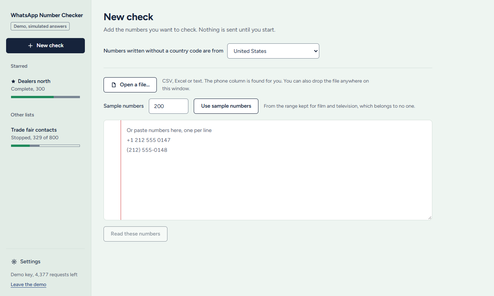
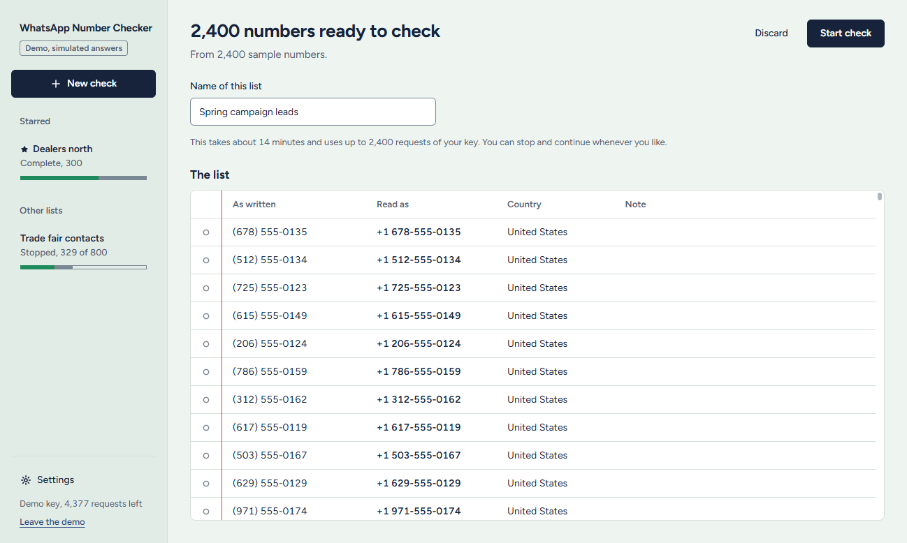
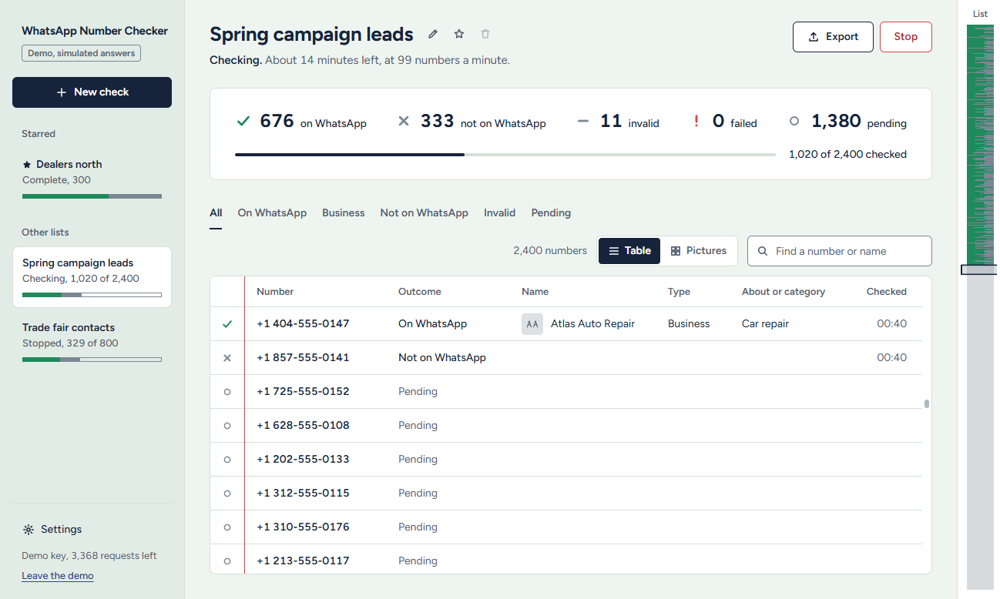
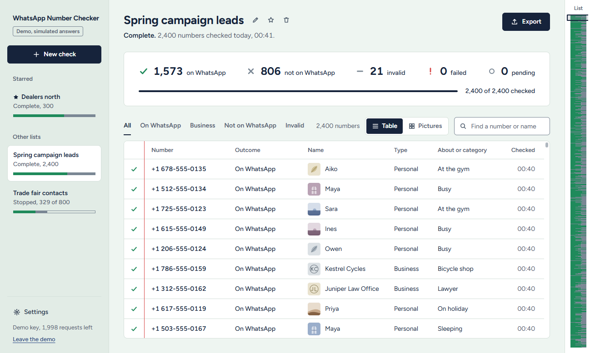
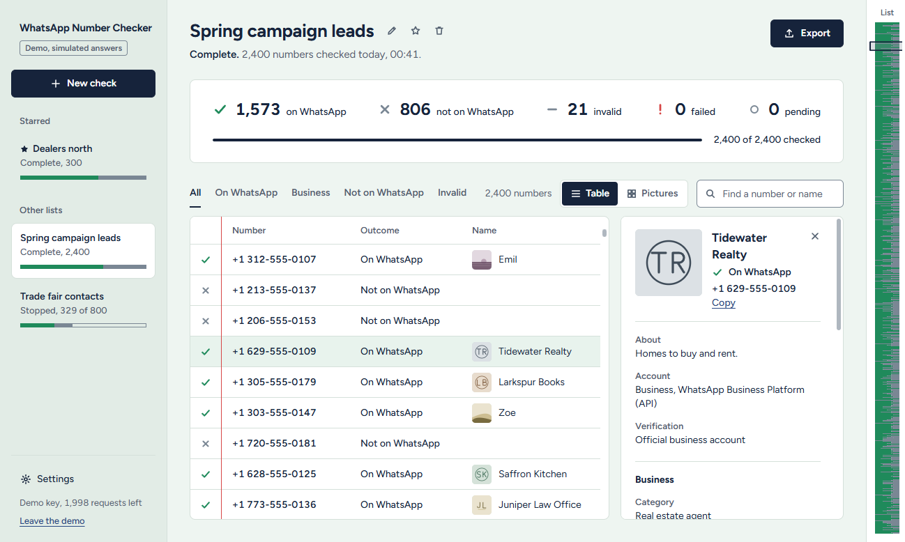
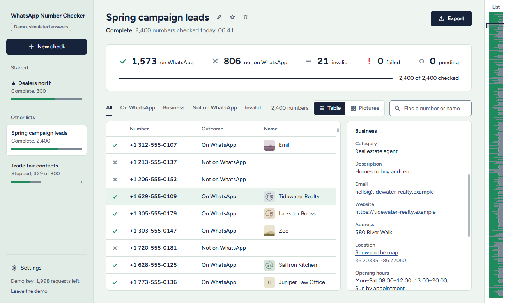
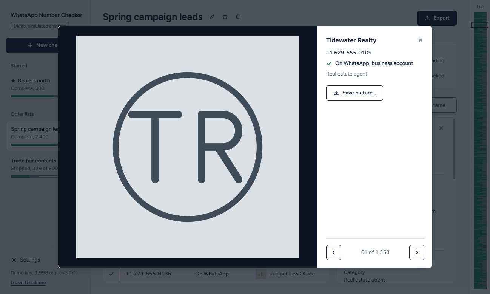
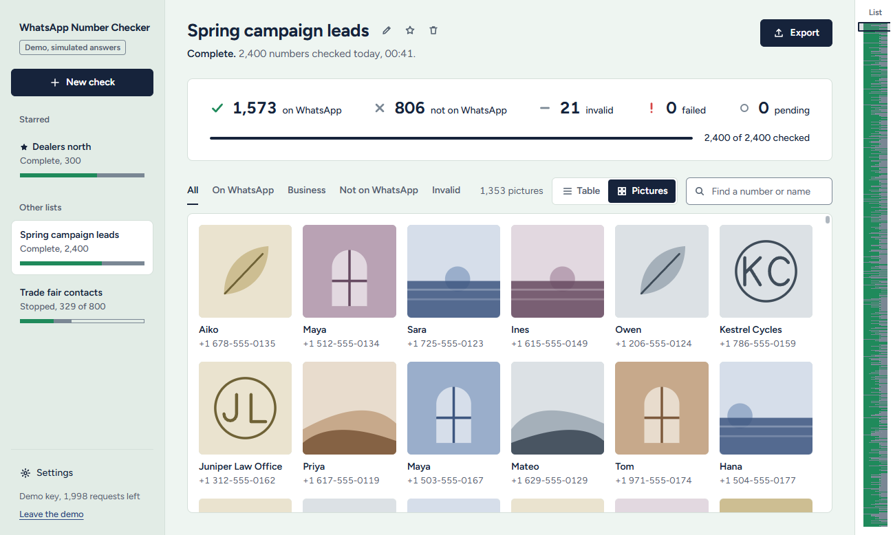
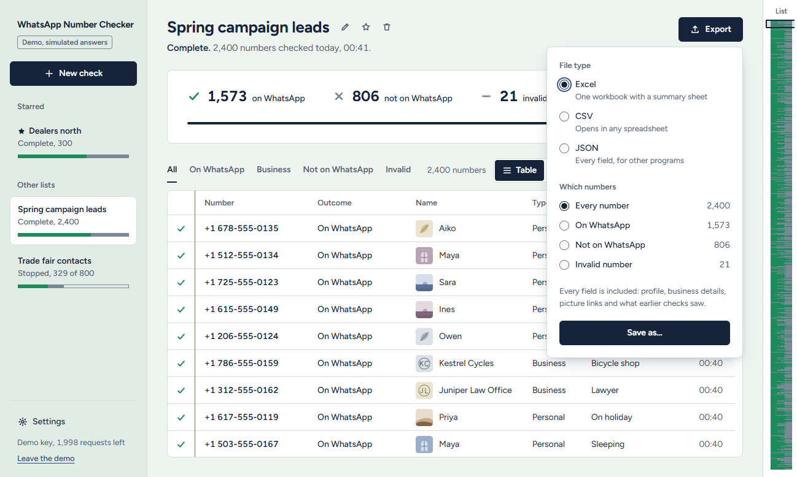
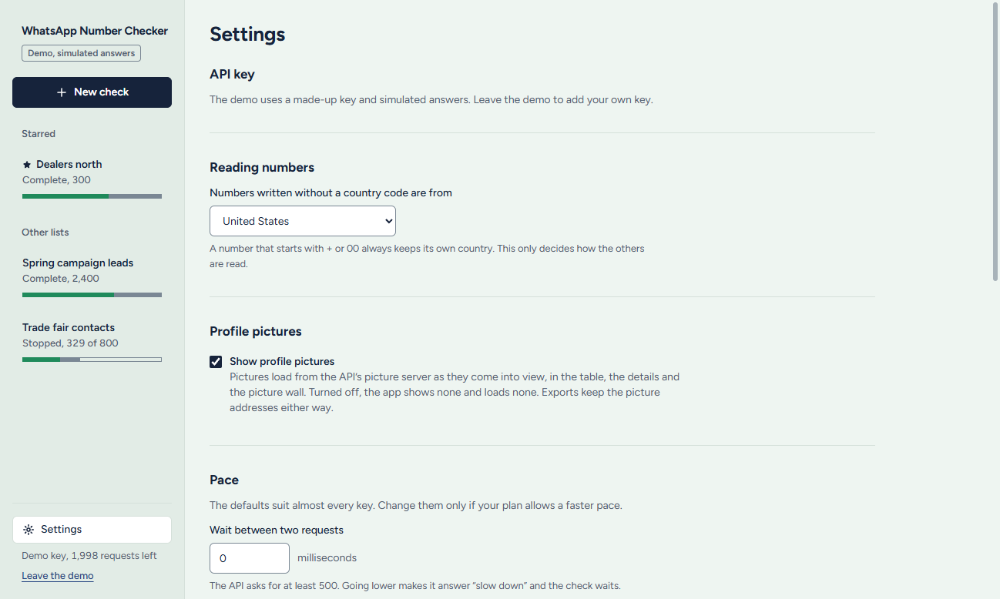

# User guide

How to install **WhatsApp Number Checker** on Windows, macOS or Linux, check
which numbers of a list are on WhatsApp, read their profiles, and export the
answers. No programming needed. In the app, **Help → User Guide** opens this
page.

> Every screenshot here comes from the app's built-in **demo mode**: the numbers
> come from the range kept for film and television, the answers are simulated
> and the pictures are drawn by the app, so no real person appears in this
> guide. You can try the demo yourself, without a key
> ([Try it without a key](#13-try-it-without-a-key)).

**Contents**

1. [What you need](#1-what-you-need)
2. [Download](#2-download)
3. [Install](#3-install): [Windows](#on-windows), [macOS](#on-macos), [Linux](#on-linux)
4. [Add your API key](#4-add-your-api-key)
5. [Add numbers](#5-add-numbers)
6. [Review the list](#6-review-the-list)
7. [Check](#7-check)
8. [Read the results](#8-read-the-results)
9. [Profile pictures](#9-profile-pictures)
10. [Export](#10-export)
11. [Your lists](#11-your-lists)
12. [Settings](#12-settings)
13. [Try it without a key](#13-try-it-without-a-key)
14. [Troubleshooting](#14-troubleshooting)
15. [Where your data is, update and uninstall](#15-where-your-data-is-update-and-uninstall)
16. [Use it responsibly](#16-use-it-responsibly)

---

## 1. What you need

- **A computer** with one of:

  | System | Versions |
  | --- | --- |
  | Windows | 10 or 11, 64-bit |
  | macOS | 12 Monterey or later, on Apple silicon (M1 and later) or Intel |
  | Linux | a 64-bit (x86-64) desktop: Ubuntu 22.04 or later, Debian 12, Linux Mint 21 or later, Fedora and others |

- **An API key** for the WhatsApp Data API. Any of these works:

  | Key | Where to get it | Each answer carries |
  | --- | --- | --- |
  | Direct key (`wapi_…`) | [whatsapp.checkleaked.cc/api](https://whatsapp.checkleaked.cc/api) | A live check with the full profile and picture |
  | RapidAPI: Number Validator | [rapidapi.com/airaudoeduardo/api/whatsapp-number-validator18](https://rapidapi.com/airaudoeduardo/api/whatsapp-number-validator18) | A live check: on WhatsApp or not, no profile |
  | RapidAPI: DB Only | [rapidapi.com/airaudoeduardo/api/wp-data-db-only](https://rapidapi.com/airaudoeduardo/api/wp-data-db-only) | Profiles from the database, no live check |

  A RapidAPI key is a long key with `msh` and `jsn` in it. Every number costs one
  request, whatever its answer.

- **Your list of numbers**: a CSV or Excel file, a text file, or numbers you can
  copy and paste.

## 2. Download

Go to the [latest release](https://github.com/eduair94/whatsapp-scraping-tool/releases/latest)
and pick the file for your computer:

| System | File | Choose it if |
| --- | --- | --- |
| Windows | [whatsapp-number-checker-windows-setup.exe](https://github.com/eduair94/whatsapp-scraping-tool/releases/latest/download/whatsapp-number-checker-windows-setup.exe) | You want a normal installed app with a Start menu entry and an uninstaller. **Recommended.** |
| Windows | [whatsapp-number-checker-windows-portable.exe](https://github.com/eduair94/whatsapp-scraping-tool/releases/latest/download/whatsapp-number-checker-windows-portable.exe) | You don't want to install anything. It starts a little slower, because it unpacks itself each time. |
| macOS | [whatsapp-number-checker-mac-arm64.dmg](https://github.com/eduair94/whatsapp-scraping-tool/releases/latest/download/whatsapp-number-checker-mac-arm64.dmg) | Your Mac has Apple silicon (M1, M2, M3, M4…). |
| macOS | [whatsapp-number-checker-mac-x64.dmg](https://github.com/eduair94/whatsapp-scraping-tool/releases/latest/download/whatsapp-number-checker-mac-x64.dmg) | Your Mac has an Intel processor. |
| Linux | [whatsapp-number-checker-linux-x64.deb](https://github.com/eduair94/whatsapp-scraping-tool/releases/latest/download/whatsapp-number-checker-linux-x64.deb) | Ubuntu, Debian, Linux Mint, Pop!_OS and other Debian-based systems. **Recommended there.** |
| Linux | [whatsapp-number-checker-linux-x64.AppImage](https://github.com/eduair94/whatsapp-scraping-tool/releases/latest/download/whatsapp-number-checker-linux-x64.AppImage) | Any other distribution (Fedora, Arch, openSUSE…), or if you'd rather not install anything. |

**Which Mac do I have?** Apple menu → **About This Mac**. It says *Chip: Apple M…*
for Apple silicon, or *Processor: … Intel …* for Intel.

**Your browser may warn you** that the file "isn't commonly downloaded". That's
because the app is new and not code-signed. In Edge, open the download list,
click **…** next to the file → **Keep** (and, if it asks again, **Show more** →
**Keep anyway**).

### Check the file (optional)

The release also has `SHA256SUMS.txt`, with a fingerprint for every file:

- **Windows**: in **PowerShell**, in your Downloads folder, run
  `Get-FileHash .\whatsapp-number-checker-windows-setup.exe -Algorithm SHA256`.
  The `Hash` must match that file's line in `SHA256SUMS.txt`.
- **macOS**: in **Terminal**, run
  `shasum -a 256 ~/Downloads/whatsapp-number-checker-mac-arm64.dmg` (or `-x64`)
  and compare.
- **Linux**: run `cd ~/Downloads && sha256sum --check --ignore-missing SHA256SUMS.txt`.
  It prints `OK` next to each file you downloaded.

## 3. Install

### On Windows

1. Double-click `whatsapp-number-checker-windows-setup.exe`.
2. If Windows shows **"Windows protected your PC"**, click **More info**, then
   **Run anyway**. Windows shows this for every app that isn't code-signed yet.
3. Choose **Only for me** (no administrator rights needed) or
   **Anyone who uses this computer**, keep the suggested folder, and click
   **Install**, then **Finish**.

From now on, open **WhatsApp Number Checker** from the Start menu or the desktop
shortcut. With the portable file, skip all of this: double-click it (and pass
the same warning the first time).

### On macOS

1. Double-click the `.dmg` you downloaded. In the window that opens, drag
   **WhatsApp Number Checker** onto the **Applications** folder.
2. Eject the disk image (the ⏏ button next to it in Finder's sidebar).
3. Open **Applications** and double-click **WhatsApp Number Checker**.

The first time, macOS stops it, because the app isn't notarized by Apple yet:

- **macOS 15 Sequoia and later**: macOS says *"WhatsApp Number Checker" Not
  Opened*. Click **Done**. Open **System Settings → Privacy & Security**, scroll
  down to *"WhatsApp Number Checker" was blocked to protect your Mac*, click
  **Open Anyway**, enter your password, and click **Open Anyway** once more.
- **macOS 14 Sonoma and earlier**: Control-click (or right-click) the app in
  Applications, choose **Open**, then click **Open** in the message.

You only do this once. If macOS ever says the app **"is damaged and can't be
opened"**, run this once in **Terminal**, then open it again:

```sh
xattr -dr com.apple.quarantine "/Applications/WhatsApp Number Checker.app"
```

When you save your key, macOS may ask whether *WhatsApp Number Checker* may use
*"WhatsApp Number Checker Safe Storage"* in your keychain: that's where your key
is kept, encrypted. Click **Always Allow**. It can ask again after an update.

On a Mac, the menus (**File**, **Help**…) are in the menu bar at the top of the
screen.

### On Linux

**With the `.deb`** (Ubuntu, Debian, Mint…), open a terminal and run:

```sh
cd ~/Downloads
sudo apt install ./whatsapp-number-checker-linux-x64.deb
```

Then open **WhatsApp Number Checker** from your applications menu.

**With the AppImage**, run:

```sh
cd ~/Downloads
chmod +x whatsapp-number-checker-linux-x64.AppImage
./whatsapp-number-checker-linux-x64.AppImage
```

Keep it somewhere permanent, such as `~/Applications`. AppImages need FUSE 2: if
nothing happens, see [Troubleshooting](#14-troubleshooting). On Ubuntu 23.10 and
later the AppImage turns Chromium's security sandbox off by itself to start; the
`.deb` keeps it on, which is why it's the better choice on Ubuntu.

Your key can be stored only if your desktop has a keyring (GNOME Keyring or
KWallet; Ubuntu, Mint, Fedora and KDE desktops have one). Without one, the app
keeps the key until you close it, and you paste it again next time.

## 4. Add your API key

The first time, the app opens on **New check** and asks for your key.

1. Paste it into the **Paste your key** box and click **Save key**.
2. A direct key is checked at once, for free: a tick and a line such as
   *"Pro key accepted: 43,816 requests left, valid until 2027-05-01."*, or the
   reason it was refused. A RapidAPI key is checked on your first check (checking it on its
   own would cost a request); you can also press **Check this key** in Settings.

The key is stored encrypted by your system and sent only to the API. The window
of the app never sees it: Settings shows only its last four characters.

**Which RapidAPI listing?** The app can't tell from a RapidAPI key which listing
you subscribed to. It sends it to the **Number Validator** unless you choose
**RapidAPI: DB Only** in **Settings → Where the key is sent**.

## 5. Add numbers



1. **Choose the country** for numbers written without a country code, at the
   top. *(212) 555-0147* means nothing without a country; a number that starts
   with `+` or `00` always keeps its own.
2. Add the numbers, any of these ways:
   - **Open a file…**: CSV, Excel (`.xlsx`, `.xls`), `.tsv` or text. When a file
     has several columns, the column that holds phone numbers is found for you.
   - **Drop a file** anywhere on the window.
   - **Paste** numbers into the box, one per line (or separated by commas), and
     click **Read these numbers**.
   - **File → Open a List…** (<kbd>Ctrl</kbd>+<kbd>O</kbd>, <kbd>⌘</kbd>+<kbd>O</kbd> on a Mac).

Nothing is sent to the API yet.

## 6. Review the list



The app shows how it read every line:

- **As written**: exactly what your list says.
- **Read as**: the number in international format.
- **Country**, and a **Note** for anything it could not read (too short, not a
  valid number for its country…). Tick **Only the N that could not be read** to
  see just those.

The heading tells you how many numbers will be checked, how many entries could
not be read, and how many duplicates were removed (two spellings of the same
number are one number). Below the name, the app estimates how long the check
takes and how many requests it uses.

- **Name of this list**: starts as the file name; change it if you like.
- Changing the **country** reads the list again right away.
- **Add more numbers** adds another file or paste to the same list.
- **Discard** drops the list.

Click **Start check** when it looks right.

## 7. Check



Numbers are asked one at a time, at the pace the API allows (about one a
second). As each answer arrives, its row gets its mark and the totals count it.

- The line under the name says what is happening: *"Checking. About 14 minutes
  left, at 99 numbers a minute."* If the API asks the app to slow down, it says
  *"Waiting"* and carries on by itself.
- The table **follows the check**, keeping the newest answers in view. Scroll
  away and it stops following; **Follow the check** brings it back.
- **Stop** ends the check at once; nothing is asked after it. Every answer so far
  is saved.
- **Continue** picks up where it stopped: it asks only the numbers without an
  answer, and the ones that failed.

You can close the app during a check: it stops cleanly and saves what it has.
Only one check runs at a time.

A check also stops by itself when going on would only fail or spend requests for
nothing: the key was rejected, it has no requests left, a daily limit was
reached, or the connection failed eight times in a row. The reason appears under
the name, and **Continue** works once it is fixed.

## 8. Read the results



Every number gets exactly one mark:

| Mark | Outcome | Meaning |
| --- | --- | --- |
| ✓ | **On WhatsApp** | The number has a WhatsApp account. |
| ✕ | **Not on WhatsApp** | It has none. |
| ? | **Not in database** | Only with **DB Only**: the database has no record of it. A live check can still answer it. |
| – | **Invalid number** | The API does not accept it as a phone number. |
| ! | **Failed** | The request got no answer (a timeout, the connection, the API). **Continue** asks it again. |
| ○ | **Pending** | Not asked yet. |

- **The totals** at the top count each outcome; the line under them shows how
  much of the list is done.
- **The tabs** show one outcome at a time, or only **Business** accounts.
- **Find a number or name** searches numbers, names, about texts and
  categories.
- **The strip on the right** is the whole list, one mark per number, top to
  bottom. The outlined window on it is the part of the list shown in the table.
  Click or drag anywhere on the strip to jump there; with the strip selected,
  the arrow keys, <kbd>Page Up</kbd>, <kbd>Page Down</kbd>, <kbd>Home</kbd> and
  <kbd>End</kbd> move through the list.

### The details of one number

Click a number to open everything known about it. <kbd>↑</kbd> and <kbd>↓</kbd>
move to the next number; <kbd>Esc</kbd> closes the details.



- **Profile**: name, picture, about (and when it was set), personal or business
  account, the kind of business account (the WhatsApp Business app, or the
  Business Platform used by larger companies), and its **verification**: an
  *official business account*, or a *verified name*.
- **Business**: category, description, email, websites, address, its place on
  the map (**Show on the map** opens OpenStreetMap), opening hours, when it
  joined WhatsApp Business, linked Instagram or Facebook accounts, and whether
  it has a product catalog. Email addresses and websites open in your mail app
  and browser when you click them.
- **Number**: country, the kind of line (mobile, fixed line, VoIP…), how your list
  wrote it, and when it was checked. With **DB Only**, also when the database
  collected the record.
- **Earlier checks saw**: about texts and pictures the number showed before.
  A number that is not on WhatsApp any more can still have these.



What each key returns differs (see [What you need](#1-what-you-need)): with the
Number Validator, numbers have no profile to show.

## 9. Profile pictures

- **In the table**, a small picture sits next to each name. A dashed frame with
  a crossed-out eye means the owner shows the picture to their contacts only; a
  frame with a crossed-out picture means there is none.
- **In the details**, click the picture to see it at full size.



- **In the viewer**, <kbd>←</kbd> and <kbd>→</kbd> (or the arrows) step through
  every picture of the list, in table order and within the tab or search you
  chose. **Save picture…** saves it as a file; **Open in the browser** opens it
  there. <kbd>Esc</kbd> closes it.
- **Pictures**, next to **Table** above the list, shows every profile picture of
  the list at once. Click one to open it in the viewer.



Pictures load from the API's picture server as they come into view. To load
none at all, untick **Settings → Profile pictures → Show profile pictures**.
Exports keep the picture addresses either way.

## 10. Export



Click **Export** (or **File → Export Results…**, <kbd>Ctrl</kbd>+<kbd>E</kbd>):

1. Choose the **file type**:
   - **Excel**: one workbook, with a *Results* sheet and a *Summary* sheet.
   - **CSV**: opens in any spreadsheet. Accents and emoji survive in Excel.
   - **JSON**: every field as data, for other programs.
2. Choose **which numbers**: every number of the list, or one outcome.
3. Click **Save as…** and pick where. When it's saved, **Show in folder** opens
   the folder.

The Excel and CSV files have one row per number, in the order of your list, with
these columns: Number, Outcome, Name, Account type, Business account,
Verification, About, About set on, Profile picture, Picture, Business category,
Business description, Email, Website, Address, Location, Opening hours, On
WhatsApp Business since, Linked accounts, Product catalog, Country, Line type,
Earlier about texts, Earlier pictures, Record date, Checked at, Note, As written
in your list.

Phone numbers stay text, so Excel never turns them into `5.98E+10`. Text that a
spreadsheet would run as a formula (a profile named `=HYPERLINK(…)`, for
example) gets a leading apostrophe and stays plain text.

## 11. Your lists

Every list you check is kept in the left column, newest first, with a small bar
that shows its outcomes. Click one to open it.

- **Rename** it with the pencil next to its name, and **star** it to keep it at
  the top.
- **Delete** it with the bin (it asks first). Files you exported are not
  touched.
- **New check** starts another list.

## 12. Settings



- **API key**: save another key, **Check this key**, or **Forget the key**.
- **Where the key is sent**: *Recognise it from the key* (a direct key goes
  direct; a RapidAPI key goes to the Number Validator), or one channel
  explicitly. Each option says what it returns.
- **Reading numbers**: the country for numbers without a country code.
- **Profile pictures**: show them, or load none.
- **Pace**: the wait between two requests (550 milliseconds; the API asks for at
  least 500), how long to wait for an answer (30 seconds) and how many times to
  try a failed request again (3). The defaults suit almost every key.
- **Light or dark**: follow the system, or choose one.
- **Demo**, **Your lists** (delete every list) and **About**, with links to this
  guide, the source code and the page to report a problem.

## 13. Try it without a key

**Help → Try the Demo** (or **Try the demo without a key** on the first screen)
switches the app to demo mode in place:

- **Sample numbers** appear on **New check**: numbers from the North American
  range 555-0100 to 555-0199, which is kept for film and television and belongs
  to no one.
- Answers are simulated on your computer. Nothing is sent anywhere.
- Your own lists and key are untouched, and come back when you click **Leave
  the demo**.

## 14. Troubleshooting

**"The API rejected this key."** Check it for missing characters (a direct key
starts with `wapi_`), and that it goes to the right place: a RapidAPI key to one
of the RapidAPI channels, a direct key to Direct key (**Settings → Where the key
is sent**).

**"This RapidAPI key is not subscribed to the chosen listing."** Subscribe to the
listing on RapidAPI, or choose the other RapidAPI channel.

**"The key has no requests left" / "reached today's limit".** The check stops and
keeps its place. Renew or upgrade the key, or wait for the daily limit to reset,
then click **Continue**.

**"Waiting. The API asked to slow down."** Normal from time to time: the app
waits and carries on by itself. If it happens all the time, raise **Settings →
Pace → Wait between two requests**.

**"The API stopped answering (8 failures in a row)."** Usually the internet
connection. Check it, then **Continue**: the failed numbers are asked again.

**Many numbers are "Not in database".** You're on **DB Only**, which reads the
database and makes no live check. A direct key or the Number Validator checks
live.

**"No phone numbers were found in this file."** The app looks for a column where
at least half the filled cells are phone numbers. Save the file as CSV, or copy
the column and paste it.

**Numbers are "Invalid" or in the wrong country.** Numbers written without a
country code are read as numbers of the country you chose. Choose the right one
on **New check** (the list is read again at once), or add the country code to
the numbers (`+44…`).

**"That file is open in another program."** Close it (often Excel), or save the
export under another name.

**Pictures don't appear.** Check that **Settings → Profile pictures** is ticked,
and that your network allows `whatsapp-db.checkleaked.com`. A business firewall
can block it.

**Linux: the AppImage does nothing.** It needs FUSE 2. On Ubuntu 24.04:
`sudo apt install libfuse2t64`; on older Ubuntu and Debian: `sudo apt install
libfuse2`. Or run it without FUSE:
`./whatsapp-number-checker-linux-x64.AppImage --appimage-extract-and-run`.

**Linux: the key is asked for every time.** Your desktop has no keyring, so the
key is never written to disk. Install GNOME Keyring or KWallet to keep it.

**macOS: "is damaged and can't be opened".** Run
`xattr -dr com.apple.quarantine "/Applications/WhatsApp Number Checker.app"`
once in Terminal.

Something else? [Report a problem](https://github.com/eduair94/whatsapp-scraping-tool/issues)
with what you did and what happened. Never include your key.

## 15. Where your data is, update and uninstall

Your lists, results and settings stay on your computer:

| System | Folder |
| --- | --- |
| Windows | `%APPDATA%\WhatsApp Number Checker` |
| macOS | `~/Library/Application Support/WhatsApp Number Checker` |
| Linux | `~/.config/WhatsApp Number Checker` |

Each list is a folder in `lists`, with its numbers and one line per answer.
Coming from version 1? Its sessions are moved over the first time version 2
starts, and the key that version 1 wrote into them is removed.

**Update**: download the new version and install it over the old one (on a Mac,
replace the app in Applications; on Linux, `sudo apt install` the new `.deb` or
replace the AppImage). Your lists and key stay.

**Uninstall**:

- **Windows**: **Settings → Apps → Installed apps → WhatsApp Number Checker →
  Uninstall**. The portable app is just the file: delete it.
- **macOS**: drag **WhatsApp Number Checker** from Applications to the Trash.
- **Linux**: `sudo apt remove whatsapp-number-checker`, or delete the AppImage.

Uninstalling keeps your data folder, in case you come back. Delete it too to
remove every list and the stored key.

## 16. Use it responsibly

- Check numbers you have a reason to hold: your customers, your own leads, a
  list you are cleaning.
- Before you message anyone on WhatsApp, make sure they agreed to it. WhatsApp's
  own rules and data-protection laws such as the GDPR require it.
- Profiles, about texts and pictures belong to real people. Keep what you export
  safe, and only as long as you need it.
- Anyone can hide their number from the database at
  [whatsapp.checkleaked.cc/opt-out](https://whatsapp.checkleaked.cc/opt-out).

WhatsApp Number Checker is an independent, open-source project. It is not
affiliated with, endorsed by or sponsored by WhatsApp or Meta.
